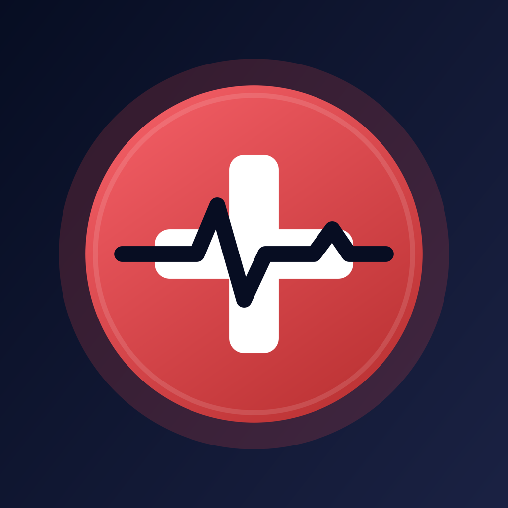
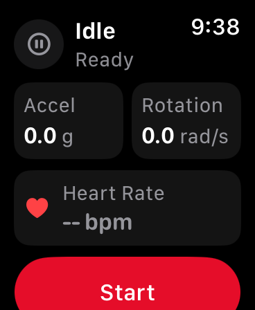
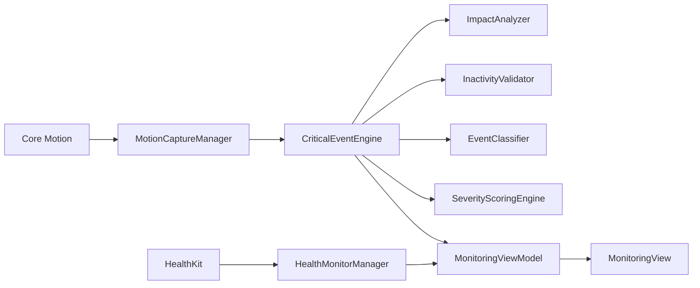

<p align="center">
  
</p>

<h1 align="center">iRescue</h1>

<p align="center">
  <strong>A watchOS safety prototype exploring real-time fall and impact detection through motion intelligence and health signals.</strong>
</p>

<p align="center">
  
  
  
  
</p>

<p align="center">
  
</p>

## Vision

Falls and sudden impacts are time-sensitive events. For people who live alone, work alone, or train outdoors, the critical gap is often not only the incident itself—it is the time before anyone realizes that help may be needed.

**iRescue explores how an Apple Watch can become a privacy-conscious safety layer**: one that moves beyond raw sensor thresholds by correlating impact dynamics, post-impact inactivity, and heart-rate context to build higher-confidence emergency awareness.

The long-term vision is an on-device rescue pipeline that can distinguish meaningful critical events, give users an opportunity to cancel false alarms, and escalate high-confidence incidents with the minimum possible delay.

> [!IMPORTANT]
> iRescue is an engineering prototype and portfolio project. It is **not** a certified medical device, not a replacement for emergency services, and not a substitute for Apple’s built-in safety features. It does not currently contact emergency services or emergency contacts automatically.

## What the Prototype Does Today

- Captures Apple Watch device motion at **100 Hz** using Core Motion.
- Detects impact candidates from combined acceleration and rotation magnitude.
- Maintains a rolling motion buffer for temporal context.
- Validates impact candidates against a **10-second post-impact inactivity window** to reduce single-threshold false positives.
- Classifies validated events as vertical falls or lateral impacts.
- Scores event severity from impact magnitude and sustained inactivity, with biometric deviation support in the scoring engine.
- Streams heart-rate updates through HealthKit after user authorization.
- Presents live motion, heart-rate, and system status in a compact SwiftUI interface.
- Keeps processing on-device; there is no backend service or external dependency.

## Detection Pipeline

| Stage | Current implementation | Purpose |
| --- | --- | --- |
| Capture | `CMDeviceMotion` sampled at 100 Hz | Collect acceleration, rotation, and attitude context |
| Impact hypothesis | acceleration ≥ 2.8g and rotation > 5 rad/s | Identify physically significant impact candidates |
| Temporal validation | 10 seconds below 0.15g acceleration and 0.1 rad/s rotation | Reduce false positives from normal sudden movements |
| Classification | dominant-axis motion heuristic | Distinguish vertical falls from lateral impacts |
| Severity scoring | weighted impact + inactivity model, with optional biometric component | Estimate event criticality for future escalation decisions |
| Presentation | Combine-driven `@Published` state | Surface live monitoring and alert state in SwiftUI |

## Architecture



The project follows a small feature-first MVVM architecture:

- **`App/`** contains application composition and startup.
- **`Features/Monitoring/`** contains the user-facing monitoring experience.
- **`Core/Sensors/`** isolates framework-bound sensor integrations.
- **`Core/Detection/`** contains the event-detection pipeline.
- **`Core/Models/`** contains domain models decoupled from Core Motion types.
- **`Resources/`** contains assets, app icon, accent color, and entitlements.

## Project Structure

```text
.
├── iRescue.xcodeproj/
├── iRescue Watch App/
│   ├── App/
│   │   ├── ContentView.swift
│   │   └── iRescueApp.swift
│   ├── Core/
│   │   ├── Detection/
│   │   │   ├── CriticalEventEngine.swift
│   │   │   ├── EventClassifier.swift
│   │   │   ├── ImpactAnalyzer.swift
│   │   │   ├── InactivityValidator.swift
│   │   │   └── SeverityScoringEngine.swift
│   │   ├── Models/
│   │   │   ├── CriticalEvent.swift
│   │   │   ├── MotionBuffer.swift
│   │   │   ├── MotionSample.swift
│   │   │   ├── RescueDetectionState.swift
│   │   │   ├── SeverityLevel.swift
│   │   │   └── UserBiometric.swift
│   │   └── Sensors/
│   │       ├── HealthMonitorManager.swift
│   │       └── MotionCaptureManager.swift
│   ├── Features/
│   │   └── Monitoring/
│   │       ├── ViewModels/
│   │       └── Views/
│   └── Resources/
│       ├── Assets.xcassets/
│       └── iRescue Watch App.entitlements
├── iRescue Watch AppTests/
├── iRescue Watch AppUITests/
└── docs/
    ├── assets/
    └── screenshots/
```

## Engineering Highlights

- **Testable domain boundary:** `MotionVector` and `AttitudeSample` decouple detection logic from Core Motion runtime types, making the core rules straightforward to unit test.
- **Multi-stage confidence building:** the detector does not treat one large acceleration spike as an emergency; it requires temporal evidence of post-impact inactivity.
- **Reactive data flow:** Combine streams connect sensor capture, detection, and UI state while SwiftUI rendering remains isolated on the main actor.
- **Dependency injection:** sensor managers can be injected into the monitoring view model, supporting future mocks and preview data.
- **Privacy-aware foundation:** motion and HealthKit purpose strings are explicit, HealthKit entitlements are configured, and processing remains local to the device.
- **No external dependencies:** the project uses only Apple frameworks, keeping the codebase auditable and easy to build.

## Tech Stack

- Swift 5
- SwiftUI
- Combine
- Core Motion
- HealthKit
- XCTest / Swift Testing
- watchOS 26.2+

## Getting Started

### Requirements

- macOS with Xcode 27.2 or later
- Apple Watch Simulator running watchOS 26.5, or a physical Apple Watch running watchOS 26.2+

### Run Locally

```bash
git clone https://github.com/beltradini/iRescue.git
cd iRescue
open iRescue.xcodeproj
```

1. Open `iRescue.xcodeproj` in Xcode.
2. Select the **iRescue Watch App** scheme.
3. Choose an Apple Watch Simulator or a connected Apple Watch.
4. Build and run.

For a physical device, select your development team in **Signing & Capabilities**. The project already includes the HealthKit entitlement and the motion/HealthKit privacy descriptions required at runtime.

## Testing

Run the unit test target from the command line:

```bash
xcodebuild test \
  -project "iRescue.xcodeproj" \
  -scheme "iRescue Watch App" \
  -destination 'platform=watchOS Simulator,name=Apple Watch SE 3 (44mm)' \
  -only-testing:"iRescue Watch AppTests"
```

The tests cover impact detection, event classification, inactivity validation, rolling-buffer behavior, and severity scoring.

## Roadmap

- [ ] Emergency-contact and location-sharing escalation flow
- [ ] User confirmation countdown with false-alarm cancellation
- [ ] Extended-runtime/background monitoring strategy
- [ ] Personalized biometric baselines using resting heart rate and HRV
- [ ] Richer fall-state machine using the domain states already modeled in `RescueDetectionState`
- [ ] Validation against labeled fall datasets and real-world pilot testing
- [ ] On-device model personalization with privacy-preserving adaptation
- [ ] Accessibility-first alert presentation and haptic escalation

## Author

Created by **Alejandro Beltrán** as a watchOS engineering and product-design portfolio project.
